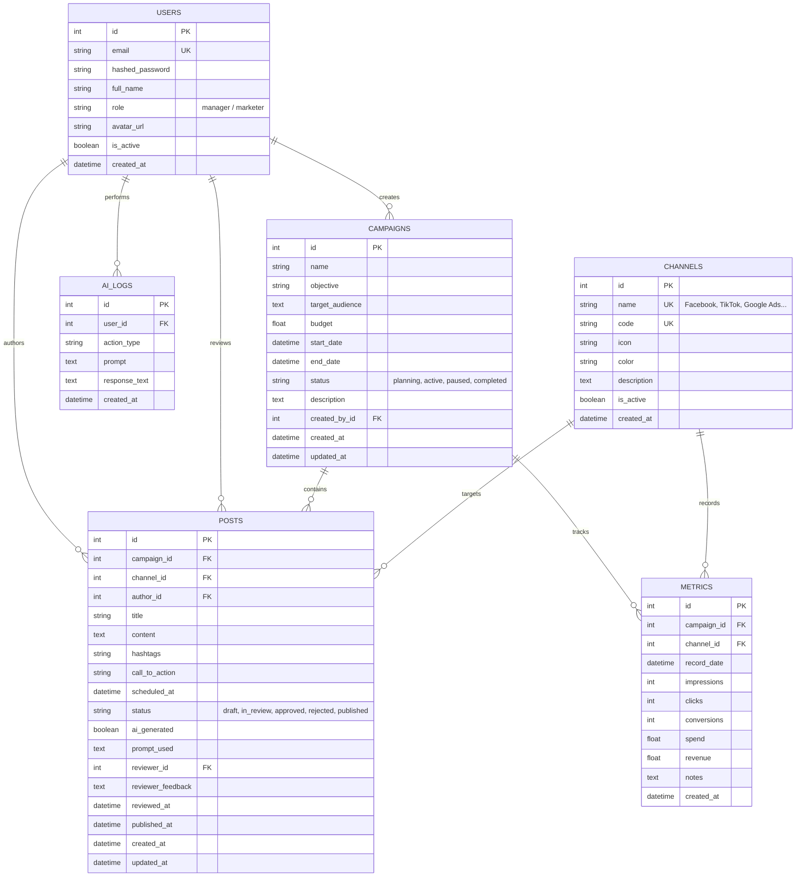

# THIẾT KẾ CƠ SỞ DỮ LIỆU & SƠ ĐỒ THỰC THỂ QUAN HỆ (ERD)

## 1. Sơ đồ Thực thể Quan hệ (ERD)

---

## 2. Công thức Chỉ số Nghiệp vụ (Key Marketing Formulas)

1. **Tỷ lệ nhấp chuột (Click-Through Rate - CTR)**:
   $$\text{CTR} = \frac{\text{Clicks}}{\text{Impressions}} \times 100\%$$

2. **Chi phí trên mỗi lượt nhấp (Cost Per Click - CPC)**:
   $$\text{CPC} = \frac{\text{Spend}}{\text{Clicks}} \text{ (VNĐ)}$$

3. **Chi phí trên mỗi lượt chuyển đổi (Cost Per Acquisition - CPA)**:
   $$\text{CPA} = \frac{\text{Spend}}{\text{Conversions}} \text{ (VNĐ)}$$

4. **Tỷ suất sinh lời trên chi phí marketing (Return on Investment - ROI)**:
   $$\text{ROI} = \frac{\text{Revenue} - \text{Spend}}{\text{Spend}} \times 100\%$$
